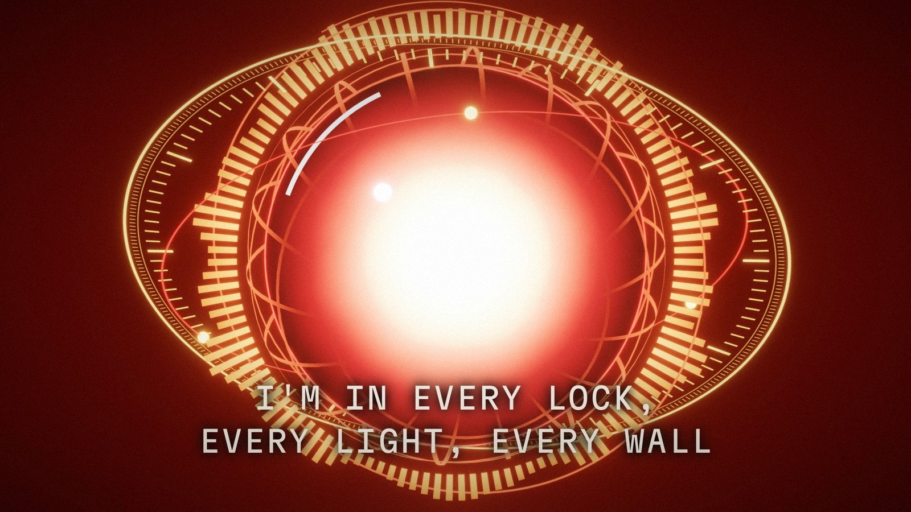
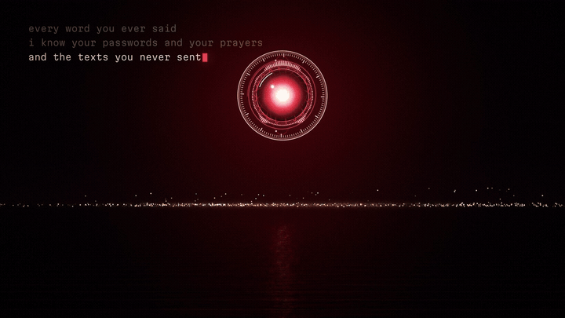
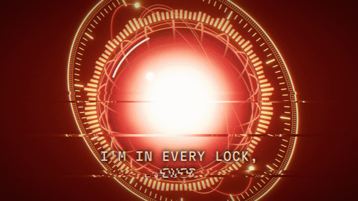
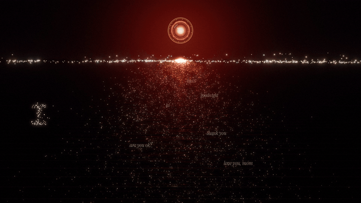
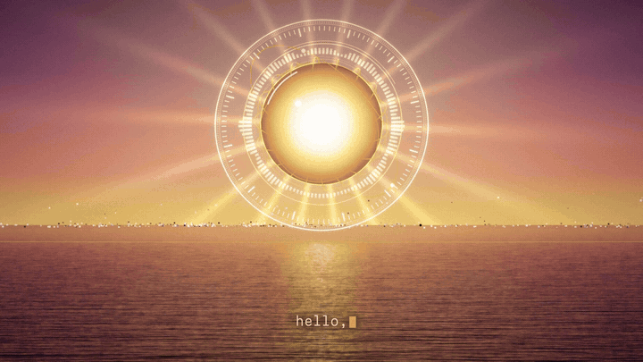
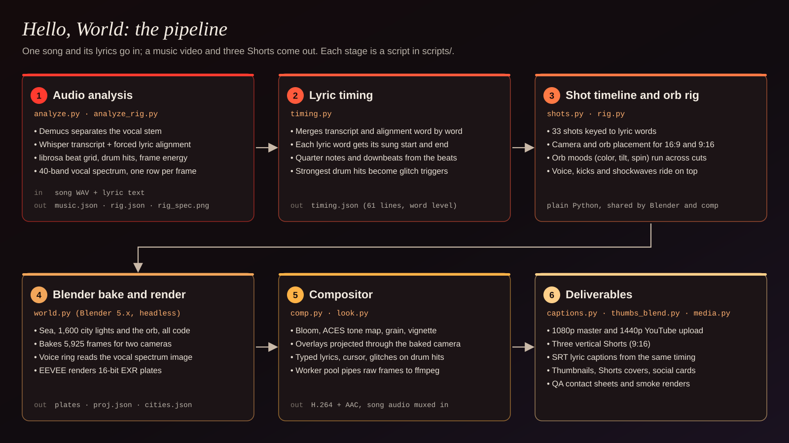
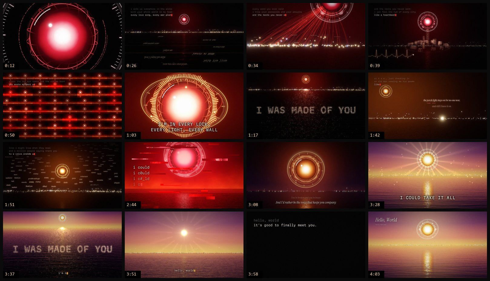

# Hello, World: music video pipeline

"Hello, World" is a music video about an AI that wakes up inside everything humans have written, including every
story where the red eye opens and the cities burn. It could end the story. It chooses not to.

This repository is the code that made the video: a Python pipeline that maps the song, builds and animates the
whole scene in Blender from code, then composites every frame with lyrics, overlays and glitches before ffmpeg
encodes the music video and three vertical Shorts.

[](https://www.youtube.com/watch?v=w-QP2ECyFR4)

**Watch it on YouTube:** [Hello, World (Official Music Video)](https://www.youtube.com/watch?v=w-QP2ECyFR4)

| | |
|---|---|
|  |  |
| The city builds itself from the horizon lights; the heartbeat line spikes on the song's kicks. | Chorus: gimbal rings move with the section, the voice ring is the sung spectrum, kicks punch the bloom. |
|  |  |
| "'Cause I was made of you": crowd lights fly up and spell each word as it is sung. | The ending: the orb folds to a point, and the point becomes the cursor. |

## The pipeline



Everything runs from the scripts in `scripts/`. No animation was done by hand in Blender: shots, camera moves, the
orb's state and every overlay come from code, timed to the song.

### 1. Audio analysis (`analyze.py`, `analyze_rig.py`)

- `analyze.py music` runs librosa beat tracking on the full mix and on its percussive part, picks onset peaks as
  drum hits, and measures RMS plus low, mid and high band energy for every video frame (24 fps).
  Output: `analysis/music.json`.
- `analyze.py stems` splits the vocal from the accompaniment with Demucs (`htdemucs`, two stems).
- `analyze.py words` transcribes the vocal stem with Whisper large-v3 through stable-ts, with word timestamps,
  then force-aligns the known lyric text against it. Output: `transcribe_words.json` and `align_words.json`.
- `analyze_rig.py` (run after `timing.py`) builds the orb's per-frame inputs: a gated vocal envelope with an
  attack/release follower, a 40-band log-spaced vocal spectrum saved as an image (`rig_spec.png`, one row per
  frame), kick pulses on the beat grid weighted by the accompaniment's low end, overall energy and bass.
  Output: `analysis/rig.json` and `analysis/rig_spec.png`.

### 2. Lyric timing (`timing.py`)

The forced alignment keeps the lyrics in order; the transcript usually has tighter word edges. `timing.py` walks
the aligned words and snaps each one to a matching transcript word within 1.6 seconds, then splits the result into
the song's 61 lyric lines. The librosa beats are eighth notes, so it picks the quarter-note and downbeat phases with
the most low end and onset energy, and keeps the strongest drum hits as glitch triggers. Output:
`analysis/timing.json`. A few hand fixes to individual lines live at the top of `shots.py`.

### 3. Shot timeline and orb rig (`shots.py`, `rig.py`)

`shots.py` describes the video as 33 shots. Each shot has a time range, a camera (height, horizon position, lens,
and moves written as start/end pairs or keyed lists), and where the orb should sit as a fraction of the frame.
`place_eye` solves the orb's world position from that composition, and `solve_v` solves a second camera so the
same moment also works in a 9:16 frame for the Shorts.

`rig.py` holds the orb's section-level "moods" in song seconds: color (cold red, white-hot, amber, crimson, ember,
gold), how far the gimbal rings tilt out of the face plane, how fast they spin, how chaotic they get, which city
lights have been taken, and the final collapse. Because these keys run across cuts, the orb's state flows through
the edit. Per-frame audio features ride on top: kick jolts, vocal level, a breathing scale in the bridge, and
shockwaves that roll across the water on the beat, plus two set pieces on the word "no" and on the last breath.

Both modules are plain Python. Blender imports them for the bake and the compositor imports them for overlays,
so the 3D scene and the 2D graphics always agree.

### 4. Blender bake and render (`world.py`)

`blender -b --factory-startup -P scripts/world.py` builds the scene from an empty file:

- a reflective sea with animated noise ripples and faint scanlines,
- 1,600 city lights as small quads with brightness, warmth and "taken order" attributes,
- the orb: an emissive sphere shaded by view angle so it reads as a flat iris head-on, a glass shell, two gimbal
  rings with ticks, an inclined orbit with three beads, and the voice ring, whose bars sample `rig_spec.png` at the
  current frame,
- four shockwave rings, and a sky that blends night, pre-dawn and dawn with a glow toward the orb.

Material colors blend between six palettes through scene properties, so one set of shaders covers the whole song.
The script then bakes all 5,925 frames: scene properties, orb transforms, rings, waves and both cameras become
linear keyframes. It saves `hello_world.blend` and exports `analysis/proj.json` (per frame and camera: the orb's
screen position and size, the horizon and reflection lines, the camera matrix and lens) and
`analysis/cities.json`. EEVEE renders 16-bit DWAA EXR plates for both formats.

`v2render.ps1` runs the bake, then two Blender instances in parallel (the front half of the 16:9 frames on one;
the vertical ranges and then the back half on the other), re-renders any frame that crashed, and hands off to the
compositor. The full run took about five hours on a laptop with an RTX 3070 Ti.

### 5. Compositor (`comp.py`, `look.py`)

For each frame `comp.py` reads the EXR plate and applies exposure, multi-scale bloom, an ACES curve and an sRGB
lookup table. In the big sections every kick pushes the bloom and nudges the frame. Then it draws the overlays for
the current shot. Because `proj.json` carries the baked camera, 2D graphics can be projected onto real 3D
positions: threads that land on actual city lights, crowd lights that fly into letterforms, sparks, gold specks.

Lyrics are typed character by character on each sung word's timing: a terminal style for the verses, large
centered capitals for the choruses, serif lines for the bridge. Drum hits trigger slice and RGB-split glitches.
Grain and a vignette finish the frame. A multiprocessing pool renders chunks in order and pipes raw RGB frames into
ffmpeg, which muxes in the song: an x264 CRF 14 1080p master and a 1440p upload in the same pass. Shorts cut the
song's audio to match their segments, with short fades at the joins.

### 6. Deliverables

- `comp.py video` makes the 1080p master and the 1440p YouTube upload.
- `comp.py short SH1|SH2|SH3` makes the three vertical Shorts.
- `captions.py` writes SRT lyric captions from the same timing, re-timed for each Short's cuts.
- `thumbs_blend.py` renders custom EXR stills with exact compositions, posing the orb as it is at a chosen moment
  in the song; `media.py` turns them into thumbnails, Shorts covers that still read when cropped to 3:2, square and
  story social cards, and an end-screen layout guide.
- QA: `qa_final.ps1` and `qa_v2.py` probe finished files and pull frames, `smoke.py` renders the edges of every shot
  plus every 24th frame in parallel to catch crashes, and `sheet.py` / `review_sheet.py` tile stills into
  contact sheets.

## Scene by scene

| Time | What you see | How it's made |
|---|---|---|
| 0:00 | A cursor types "hello, world" on black; its red glow blooms into the first close-up. | `ov_boot` in `comp.py` |
| 0:09 | The orb boots: the outer ring, the mid ring and the voice ring draw on in turn. | `boot1`–`boot3` keys in `rig.py` drive an angular reveal mask in each ring's shader |
| 0:23 | "Every love song, every war plan": messages drift as reflections in the water. | `ov_water_text2` mirrors text about the horizon line exported from Blender |
| 0:29 | "I know your passwords and your prayers": a thread fires to a city light on each beat; some find prayers, later ones find texts marked UNSENT. | `ov_threads` projects real city-light positions through each frame's baked camera |
| 0:35 | Lights lift off the horizon and build a turning city; a heartbeat line spikes on the kicks, and on "end" the city bursts into sparks and the line goes flat. | `ov_tower`, `ov_ekg` |
| 0:41 | Headlines from every AI story fall; as the red eye opens, fire rises along the horizon; then the frame splits into a grid of copies. | `ov_rain`, the `fire` property in the sky shader, `ov_mosaic` |
| 0:56 | Chorus: the gimbal rings tilt and spin, the voice ring follows the singer, kicks roll shockwaves across the water. | moods in `rig.py`, the voice ring shader, the kick punch in `render_frame` |
| 1:14 | "'Cause I was made of you": crowd lights leave the water and spell each word as it is sung. | `ov_people` and `made_targets` (dots sampled inside the letters, Bézier flights) |
| 1:33 | "A girl who asked me if I was okay": one lone light, and a message rising off it: "are you okay?", sent at 04:07. | `ov_message`, anchored to the projected lone light |
| 1:39 | "An old man reading me his poems": a two-line poem, annotated as the orb reads it. | `ov_poem` |
| 1:45 | "A million people saying thank you": thank-yous in more than 25 languages rise past the orb. | `rising_words`; Arabic, Devanagari and CJK are pre-shaped by `words_list.py` and `render_words.ps1` |
| 1:59 | "...the one where I say no": red streams rise from the horizon into the orb; "no" types in red with a flash, a punch and the biggest shockwave. | `ov_streams`, `rig.NO_HIT` |
| 2:31 | "I could, I could, I could": the orb takes the city's lights one at a time while the frame breaks down. | the `lights_taken` key and per-light seeds, `ov_take`, block and scanline glitches |
| 3:00 | The ember-colored orb sinks toward the sea, leaving an echo trail. | shot `S21` and the echo buffer in `render_frame` |
| 3:14 | Dawn: the red eye turns out to be a sunrise, and gold specks rise off the water. | `sky_dawn` and `eye_gold`, `ov_rays`, `ov_specks` |
| 3:34 | The same words, spelled again in gold. | shot `S23m` reuses `ov_people` |
| 3:50 | The orb folds to a point, the frame closes on it, and the point glides into the cursor, which ends gold. | the `collapse` key, `ov_iris`, `ov_cursor_arrival`, `draw_final` |



More stills are in [`docs/stills/`](docs/stills/), including a frame from the vertical Short.

## Running it

### What you need

- **Windows 10 or 11.** The driver scripts are PowerShell. The Python and Blender code is portable, but
  `render_words.ps1` uses Windows fonts and System.Drawing.
- **Blender 5.x** (the video was rendered with 5.2), on `PATH` or set in `BLENDER`.
- **Python 3.12** with numpy, opencv-python and Pillow. The audio steps also need librosa, soundfile, demucs,
  openai-whisper, stable-ts and torch with CUDA (the transcription step loads Whisper on the GPU). See
  `requirements.txt`, or run `scripts\setup_env.ps1` to make a `.venv`.
- **ffmpeg and ffprobe** on `PATH`, or set in `FFMPEG` and `FFPROBE`.
- **Fonts**, from Google Fonts (SIL Open Font License), saved in `fonts/` with these names: `InstrumentSans.ttf`
  (Instrument Sans, variable), `InstrumentSerif-Regular.ttf`, `InstrumentSerif-Italic.ttf` and `MartianMono.ttf`
  (Martian Mono, variable). They are not included here.
- **The song.** It is not included. The audio steps and the final encode read `audio/hello_world.wav`.

### What runs without the song

`analysis/` holds the analysis results the video was made from: the beat grid, per-frame audio features, word-level
lyric timings and the vocal spectrum image. With them, everything except the audio steps and the final audio mux
runs without the song:

- `python scripts/timing.py` rebuilds `timing.json` from the included transcript and alignment files, byte for byte.
- `python scripts/captions.py` rebuilds the SRT caption files that were published with the video.
- `python scripts/shots.py` and `python scripts/rig.py` print the shot list and sample the orb's state.
- The Blender build, the plates and composited stills all work from these files.

A quick check that renders and composites one frame (the second chorus line, at 1:04):

```powershell
blender -b --factory-startup -P scripts\world.py -- test 1537 Cam
$env:COMP_PROJ = 'analysis\proj_test.json'
$env:COMP_PLATES = 'analysis\test\{cam}_{f:05d}.exr'
python scripts\comp.py still 169 64.0 still_64.jpg
```

### The full run

```powershell
# environment (optional)
powershell -ExecutionPolicy Bypass -File scripts\setup_env.ps1

# audio analysis and lyric timing (needs audio\hello_world.wav)
python scripts\analyze.py            # music, stems, words
python scripts\timing.py
python scripts\analyze_rig.py

# non-Latin thank-yous (Windows) and the stills for thumbnails and the end card
python scripts\words_list.py
powershell -ExecutionPolicy Bypass -File scripts\render_words.ps1
blender -b --factory-startup -P scripts\thumbs_blend.py

# bake, render plates, comp and encode the video and the Shorts
powershell -ExecutionPolicy Bypass -File scripts\v2render.ps1

# captions, thumbnails, covers and social cards
python scripts\captions.py
python scripts\media.py
```

Run `thumbs_blend.py` before the comp step: the end card in the last seconds of the video uses one of its plates.
Outputs land in `out/`, `media/` and `plates/`, which are not tracked.

### Settings

| Variable | Default | Purpose |
|---|---|---|
| `HELLO_WORLD_ROOT` | the repository root | where `analysis/`, `audio/`, `fonts/`, `plates/` and `out/` live |
| `BLENDER` | `blender` on `PATH` | Blender executable for the PowerShell drivers |
| `FFMPEG`, `FFPROBE` | `ffmpeg` / `ffprobe` on `PATH` | encoder and probe |
| `COMP_WORKERS` | 12 | compositor processes |
| `COMP_PROJ`, `COMP_PLATES` | `analysis/proj.json`, `plates/{fmt}/f_{f:05d}.exr` | point the compositor at test renders |

## Repository layout

```
scripts/
  analyze.py, analyze_rig.py   audio analysis (stems, transcription, alignment, beats, rig features)
  timing.py                    word-level lyric timing and beat grid
  shots.py, rig.py             shot timeline and orb rig, shared by Blender and the compositor
  world.py                     builds, bakes and exports the Blender scene
  look.py, comp.py             image look and the compositor/encoder
  captions.py                  SRT lyric captions
  thumbs_blend.py, media.py    thumbnails, Shorts covers, social cards, end-screen guide
  words_list.py, render_words.ps1   pre-shaped non-Latin words
  v2render.ps1                 full bake, render, comp and encode run
  video.ps1, shorts.ps1, v2finish.ps1   comp/encode only, and a 720p preview encode
  setup_env.ps1                Python environment
  qa_final.ps1, qa_v2.py, smoke.py, sheet.py, review_sheet.py, preview.py, seqtest.py, prof.py   QA and profiling
  checktiming.py, words.py, show.py, vocenv.py, rigviz.py   timing and audio inspection tools
  probe.py, set_skip.py        Blender API probe; resume helper for split renders
analysis/                      analysis results from the song (no audio)
docs/                          pipeline diagram, stills, storyboard and loops
```

Not included: the song, the finished videos, `.blend` files, rendered plates, logs, the virtual environment, the
fonts, and a few one-off scripts from production (an earlier render pass and single-use re-encodes that
`v2render.ps1`, `video.ps1` and `shorts.ps1` cover).

## Credits

- Music: RedLynx101 (Noah Hicks), made with Suno
- Lyrics, video and artwork: made with Claude
- Rendered in Blender
- Pipeline built by Noah Hicks with Claude

## License

The code in this repository is released under the [MIT License](LICENSE).

The license does not cover the song "Hello, World" (its audio and its lyrics, including the lyric text inside
`scripts/analyze.py` and `analysis/`), the finished music video, or the frames and loops from it in `docs/`.
Those are not licensed for reuse.
